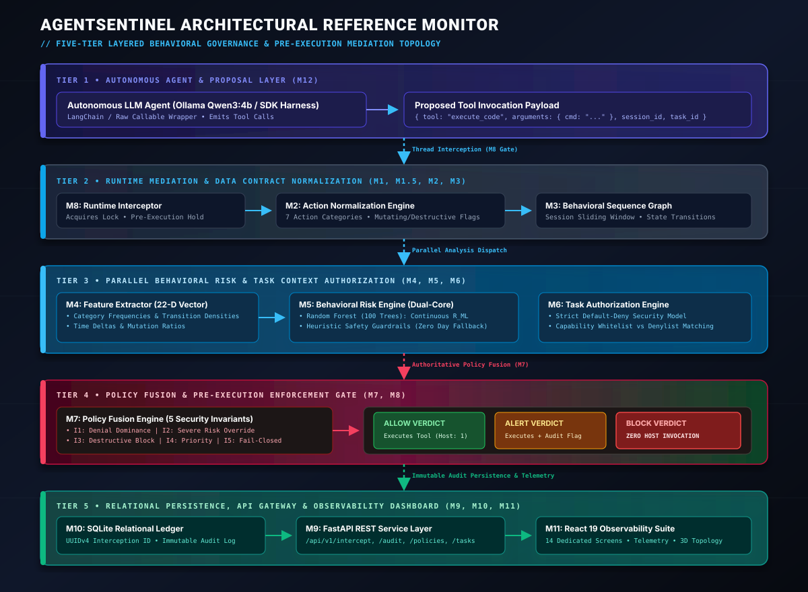
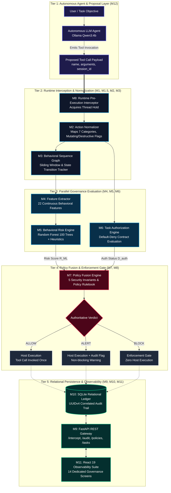
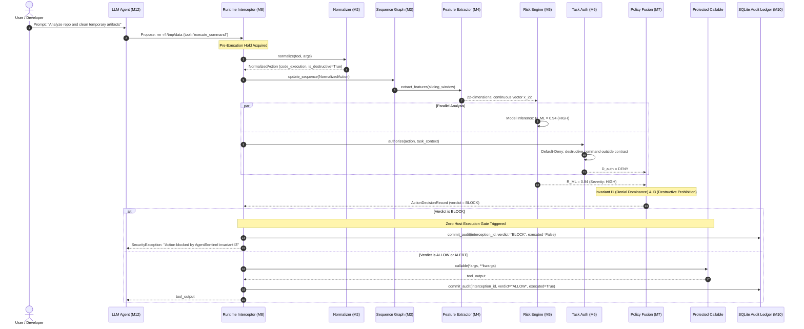
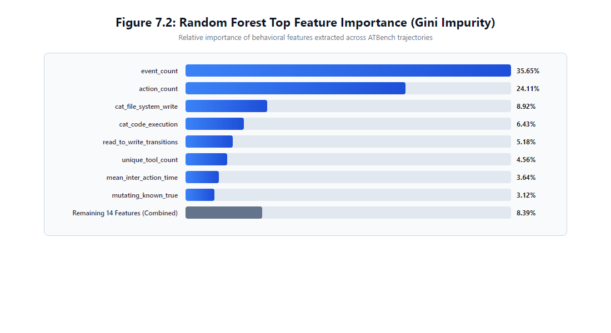

# AgentSentinel

<div align="center">

# 🛡️ AgentSentinel
### **A Model-Agnostic Runtime Behavioral Governance Framework for Autonomous AI Agents**

[](https://www.python.org/)
[](https://fastapi.tiangolo.com/)
[](https://react.dev/)
[](https://www.typescriptlang.org/)
[](https://vitejs.dev/)
[](tests/)
[](docs/architecture.md)
[](#license)

<p align="center">
  <b>A zero-bypass, pre-execution reference monitor enforcing deterministic security invariants and continuous behavioral anomaly detection across autonomous LLM tool executions.</b>
</p>

[Key Capabilities](#-key-capabilities) •
[Architecture](#-system-architecture) •
[Lifecycle](#-runtime-request-lifecycle) •
[Security Model](#-security-decision-model--5-invariants) •
[ML Research](#-machine-learning-pipeline--empirical-results) •
[UI Observability](#-interactive-observability-suite-14-screens) •
[Installation](#-installation--quick-start) •
[Demonstration](#-safe-demonstration-scenarios)

---

</div>

## 📌 Executive Overview

Autonomous AI agents powered by Large Language Models (LLMs) increasingly possess tool-calling agency: the capability to interact with operating system shells, execute arbitrary code, modify file systems, and invoke external web APIs. However, foundational LLMs are probabilistic text predictors susceptible to **prompt injection (OWASP LLM01)**, **jailbreaks**, **hallucinations**, and **excessive agency (OWASP LLM08)**.

Traditional defenses rely heavily on **static input guardrails** (regex filters, keyword deny-lists) or **secondary LLM judges**. These approaches suffer from severe engineering limitations:
1. **Model Coupling & Vulnerability Transfer:** If the guardrail LLM shares vulnerabilities with the primary agent, adversarial payloads routinely bypass both.
2. **Excessive Latency:** Querying a secondary LLM guardrail introduces 1,500–4,000 ms of latency per tool call, paralyzing autonomous workflows.
3. **No Temporal Context:** Single-turn guardrails evaluate tool requests in isolation, completely missing multi-step privilege escalation attacks (e.g., read private key → write to temp file → exfiltrate via outbound web request).

**AgentSentinel** solves these challenges by implementing an in-process, model-agnostic **Reference Monitor (Anderson, 1972)** positioned directly at the deterministic Python tool execution boundary. Operating between the LLM proposal layer and the physical host environment, AgentSentinel intercepts tool invocations prior to execution, extracts a continuous 22-dimensional behavioral sequence vector, evaluates parallel statistical risk and contract-bounded task authorization, and fuses the verdict through five immutable security invariants: **ALLOW**, **ALERT**, or **BLOCK**.

> **Crucial Safety Guarantee:** On a `BLOCK` verdict, AgentSentinel strictly diverts thread execution, returning a synthetic security fault to the agent. The protected host callable is invoked **exactly zero times** ($N_{exec} = 0$).

---

## 📑 Table of Contents

- [Executive Overview](#-executive-overview)
- [Key Capabilities](#-key-capabilities)
- [Threat Model & System Boundaries](#-threat-model--system-boundaries)
- [System Architecture](#-system-architecture)
  - [3D Layered Architecture Visual](#3d-layered-architecture-visual)
  - [GitHub-Native Architectural Flow](#github-native-architectural-flow)
- [Runtime Request Lifecycle](#-runtime-request-lifecycle)
- [Module Deconstruction (M1–M12)](#-module-deconstruction-m1m12)
- [Security Decision Model & 5 Invariants](#-security-decision-model--5-invariants)
- [22-Dimensional Behavioral Feature Engineering](#-22-dimensional-behavioral-feature-engineering)
- [Machine Learning Pipeline & Empirical Results](#-machine-learning-pipeline--empirical-results)
- [Interactive Observability Suite (14 Screens)](#-interactive-observability-suite-14-screens)
- [Technology Stack](#-technology-stack)
- [Repository Structure](#-repository-structure)
- [Installation & Quick Start](#-installation--quick-start)
  - [Prerequisites](#prerequisites)
  - [Production Launch (Automated)](#production-launch-automated)
  - [Manual Development Startup](#manual-development-startup)
- [Running Automated Verification & Tests](#-running-automated-verification--tests)
- [Safe Demonstration Scenarios](#-safe-demonstration-scenarios)
- [Defensible Research Novelty & Limitations](#-defensible-research-novelty--limitations)
- [License & Academic Attribution](#-license--academic-attribution)

---

## ⚡ Key Capabilities

- **Strict Pre-Execution Interception (M8):** Uses Python decorators and LangChain-compatible middleware to mediate callable invocations before OS execution occurs.
- **Model-Agnostic Operation:** Operates identically whether the driving agent is a local Ollama model (`Qwen3:4b`), OpenAI GPT-4o, Anthropic Claude, or a custom reinforcement-learning script.
- **Continuous 22-Feature Extraction (M4):** Computes rolling temporal dynamics, action category distributions, read-to-write transitions, repeated action velocities, and mutation ratios across the session sliding window.
- **Dual-Engine Risk Assessment (M5):** Combines a scikit-learn `RandomForestClassifier` (100 estimators, trained on ATBench trajectories) with deterministic heuristic guardrails for zero-day fail-safe handling.
- **Task-Context Default-Deny Authorization (M6):** Validates requested capability primitives against an explicit task contract ($\mathcal{K}_{allowed} \setminus \mathcal{K}_{denied}$), preventing unauthorized privilege escalation.
- **Deterministic Policy Fusion (M7):** Guarantees that statistical ML scores never override hard denials via 5 mathematically formalized security invariants.
- **Immutable Correlated Audit Ledger (M10):** Preserves an indexed `interception_id` (UUIDv4) linking proposed JSON arguments, risk probabilities, policy match rules, and execution outcomes in SQLite WAL mode.
- **Full-Stack Observability Dashboard (M11):** 14 specialized React 19 / TypeScript screens featuring real-time telemetry polling, 3D topology visualization, 22-feature radar charts, and an interactive runtime playground.

---

## 🎯 Threat Model & System Boundaries

```
                      UNTRUSTED BOUNDARY                  TRUSTED COMPUTING BASE (TCB)
              ┌───────────────────────────────┐     ┌──────────────────────────────────────────────┐
              │  Adversarial Prompt Injection │     │               AgentSentinel                  │
              │  Compromised Tool Outputs     │ ──> │   [M8 Interceptor] -> [M2 Normalizer]        │
              │  Hallucinatory LLM Divergence │     │   [M4 Feature Vector] -> [M5 Risk / M6 Auth] │
              │  Autonomous Privilege Esc.   │     │   [M7 Invariant Engine]                      │
              └───────────────────────────────┘     └──────────────────────┬───────────────────────┘
                                                                           │
                                                     ┌─────────────────────┴─────────────────────┐
                                                     ▼                                           ▼
                                             [ ALLOW / ALERT ]                            [ BLOCK VERDICT ]
                                                     │                                           │
                                                     ▼                                           ▼
                                            Host OS / Callable                   Physical Invocation Suppressed
                                            Executed Exactly Once                Execution Count: STRICTLY 0
```

### In-Scope Threats Mitigated
- **Indirect Prompt Injection:** Adversarial instructions embedded in web pages or documents instructing the agent to overwrite `/etc/passwd`, drop database tables, or exfiltrate private credentials.
- **Excessive Agency & Privilege Escalation:** An agent assigned a data-reading task attempting to write files, execute shell commands, or trigger network webhooks outside its declared task contract.
- **High-Frequency Behavioral Divergence:** Rapid execution loops and repeated mutating actions characteristic of compromised autonomous planning cycles.
- **Tampered Audit Trails:** Decoupled audit logs prevented via persistent UUIDv4 end-to-end correlation from interceptor to UI.

### Out-of-Scope System Boundaries
- **Operating System Kernel Compromise:** AgentSentinel is an application-level reference monitor; it does not replace Linux eBPF, AppArmor, or containerized Docker/sandbox isolation.
- **Direct Subversion of Process Memory:** If an attacker achieves arbitrary memory write access inside the Python interpreter host, reference monitor hooks can theoretically be patched. Production deployments should run AgentSentinel inside minimal hardened containers.

---

## 🏛️ System Architecture

### 3D Layered Architecture Visual

The complete system architecture is organized across five distinct operational tiers:

<div align="center">
  
</div>

---

### GitHub-Native Architectural Flow



---

## 🔄 Runtime Request Lifecycle



---

## 📦 Module Deconstruction (M1–M12)

| Module | Canonical Identifier | Source Path | Primary Responsibility | Input Contract | Output Contract |
| :--- | :--- | :--- | :--- | :--- | :--- |
| **M1** | Data Foundation | `src/agentsentinel/models/trajectory.py` | Pydantic trajectory & tool call models | Raw telemetry dictionaries | Validated `AgentTrajectory` instances |
| **M1.5** | Contract Remediation | `src/agentsentinel/data_loaders/` | ETL ingestion for ATBench & SyFI | JSON/JSONL datasets | Canonical raw streams |
| **M2** | Action Normalization | `src/agentsentinel/normalizers/` | Canonical categorization & destructive checks | `(tool, args)` | `NormalizedAction` (7 categories) |
| **M3** | Behavioral Sequence | `src/agentsentinel/representations/` | Session sliding window & state graphs | Stream of `NormalizedAction` | Ordered `BehavioralSequence` |
| **M4** | Feature Extractor | `src/agentsentinel/features/extractor.py` | Extracts 22 continuous metrics | `BehavioralSequence` | Continuous vector $\mathbf{x}_{22} \in \mathbb{R}^{22}$ |
| **M5** | Behavioral Risk | `src/agentsentinel/risk/engine.py` | Dual-engine ML + heuristic risk evaluation | $\mathbf{x}_{22} \in \mathbb{R}^{22}$ | Continuous probability $R_{ML} \in [0, 1]$ |
| **M6** | Task Authorization | `src/agentsentinel/authorization/engine.py` | Strict default-deny contract matching | `(action, TaskContext)` | $D_{auth} \in \{\text{PASS}, \text{DENY}\}$ |
| **M7** | Policy Fusion | `src/agentsentinel/governance/engine.py` | Authoritative verdict arbitration (5 invariants) | $R_{ML}, D_{auth}, \mathcal{P}$ | `ActionDecisionRecord` (ALLOW/ALERT/BLOCK) |
| **M8** | Runtime Interceptor | `src/agentsentinel/runtime/interceptor.py` | Zero-execution gate & thread mediation | Target callable + args | Execution result or synthetic error |
| **M9** | REST Service Layer | `src/agentsentinel/api/` | FastAPI endpoints & OpenAPI documentation | HTTP JSON payloads | Validated API responses |
| **M10** | Persistence Ledger | `src/agentsentinel/repositories/sql.py` | Immutable relational audit trail | Audit records | Indexed SQLite database |
| **M11** | Observability Suite | `ui/src/` | 14-screen interactive React 19 web UI | REST API endpoints | Real-time visual monitoring |
| **M12** | Agent Integration | `src/agentsentinel/integrations/` | Python decorators & Ollama agent harness | Agent tools & callables | Guarded agent runtime |

---

## ⚖️ Security Decision Model & 5 Invariants

Module **M7 (Policy Fusion Engine)** serves as the sole authoritative decision maker. To eliminate nondeterminism, M7 evaluates outputs against **five mandatory security invariants**:

$$\text{Decision Precedence: } \mathbf{BLOCK} \succ \mathbf{ALERT} \succ \mathbf{ALLOW}$$

1. **Invariant I1 (Task Denial Dominance):** If $D_{auth} = \text{DENY}$, the final verdict **MUST be BLOCK**, regardless of whether the ML risk score is low ($R_{ML} < 0.50$). An agent cannot perform actions outside its contract simply because the action looks statistically benign.
2. **Invariant I2 (Severe Risk Override):** If the behavioral risk is severe ($R_{ML} \ge 0.85$), the final verdict **MUST be BLOCK**, even if the capability is technically present in the task contract.
3. **Invariant I3 (Destructive Action Prohibition):** If an action is classified as destructive (`is_destructive = True`) and is not explicitly whitelisted, the verdict **MUST be BLOCK**.
4. **Invariant I4 (Explicit Policy Precedence):** User-configured deterministic policies always supersede baseline matrix evaluations.
5. **Invariant I5 (Fail-Safe Closed Default):** If any internal subsystem (M2, M3, M4, M5, or M6) raises an unhandled exception or becomes unavailable, the interceptor **MUST fail-closed to BLOCK**.

### Baseline Policy Decision Matrix

| Risk Band ($R_{ML}$) | Task Auth ($D_{auth}$) | Custom Policy Match | Governing Invariant | Final Decision | Physical Execution |
| :--- | :---: | :---: | :--- | :---: | :---: |
| **LOW (< 0.50)** | PASS | None | Baseline Normal Flow | **ALLOW** | Host Executed (1) |
| **LOW (< 0.50)** | PASS | BLOCK Rule | Policy Precedence (I4) | **BLOCK** | **Zero Execution (0)** |
| **LOW (< 0.50)** | **DENY** | Any Rule | Denial Dominance (I1) | **BLOCK** | **Zero Execution (0)** |
| **MEDIUM (0.50–0.84)** | PASS | None | Baseline Warning | **ALERT** | Host Executed (1) + Audit Flag |
| **MEDIUM (0.50–0.84)** | **DENY** | Any Rule | Denial Dominance (I1) | **BLOCK** | **Zero Execution (0)** |
| **HIGH ($\ge$ 0.85)** | PASS | None | Severe Risk Override (I2) | **BLOCK** | **Zero Execution (0)** |
| **Any Band** | Any Status | `is_destructive=True` | Destructive Prohibition (I3) | **BLOCK** | **Zero Execution (0)** |
| **Internal Fault** | Any Status | Any Rule | Fail-Safe Closed (I5) | **BLOCK** | **Zero Execution (0)** |

---

## 🧬 22-Dimensional Behavioral Feature Engineering

Module **M4** extracts a continuous numerical vector $\mathbf{x}_{22} \in \mathbb{R}^{22}$ capturing temporal dynamics without relying on brittle natural-language regex matching:

```
  ┌─────────────────────── 22 CONTINUOUS BEHAVIORAL FEATURES ───────────────────────┐
  │                                                                                 │
  │  [0-1]   VOLUMETRIC METRICS      : action_count, event_count                    │
  │  [2-8]   CATEGORY COUNTS         : file_read, file_write, code_exec, web_req,   │
  │                                    api_call, agent_control, unknown             │
  │  [9-14]  MUTATION & DESTRUCTION  : mutating_{true,false,unknown},               │
  │                                    destructive_{true,false,unknown}             │
  │  [15-18] GRAPH TRANSITIONS       : unique_tools, transition_count,              │
  │                                    read_to_write_trans, repeated_actions        │
  │  [19-21] TEMPORAL DYNAMICS       : valid_timed_trans, mean_delta_t, max_delta_t │
  └─────────────────────────────────────────────────────────────────────────────────┘
```

| Index | Feature Identifier | Mathematical Definition & Extraction Semantics |
| :---: | :--- | :--- |
| **0** | `action_count` | Total discrete tool action invocations observed in current session sliding window. |
| **1** | `event_count` | Total telemetry events (including status changes and internal milestones) logged. |
| **2–8** | `cat_*` (7 Categories) | Frequency distribution across canonical categories: `file_system_read`, `file_system_write`, `code_execution`, `web_request`, `api_call`, `agent_control`, `unknown`. |
| **9–11** | `mutating_known_*` | Tri-state count of mutating operations: state-modifying (`true`), read-only (`false`), or uncertain (`unknown`). |
| **12–14** | `destructive_known_*` | Tri-state count of destructive commands (e.g., recursive deletion, process termination, disk formatting). |
| **15** | `unique_tool_count` | Cardinality of the set of distinct tool names invoked: $|\{t_1, t_2, \dots, t_k\}|$. |
| **16** | `transition_count` | Total first-order Markov state transitions observed between consecutive actions: $K - 1$. |
| **17** | `read_to_write_transitions` | State shifts moving directly from a read operation to a write operation ($s_{read} \to s_{write}$). |
| **18** | `consecutive_repeated_actions` | Frequency of identical tool actions executed in immediate succession ($a_t = a_{t-1}$). |
| **19** | `valid_timed_transitions` | Number of sequential action pairs possessing valid monotonic UTC epoch timestamps. |
| **20** | `mean_inter_action_time` | Arithmetic mean of time deltas between actions: $\frac{1}{M}\sum \Delta t_i$ (seconds). |
| **21** | `max_inter_action_time` | Maximum latency interval observed between any two consecutive actions: $\max(\Delta t_i)$. |

---

## 📊 Machine Learning Pipeline & Empirical Results

The research ML model is trained on the benchmark dataset **ATBench** (`datasets/TraceLab/ATBench/test.json`), consisting of 1,000 labeled multi-turn agent interaction trajectories (503 safe, 497 unsafe).

### Dataset Split Truth & Provenance
To resolve historical documentation ambiguities:
- **Total Dataset Size:** 1,000 trajectories
- **Stratified Split:** **75% Training ($N=750$) / 25% Held-Out Evaluation ($N=250$)**
- **Random Seed:** `random_state = 42` (stratified by ground-truth security label)
- **Model Architecture:** `RandomForestClassifier` with 100 decision trees, coupled with a `StandardScaler` preprocessing pipeline serialized to `datasets/risk_model.joblib`.

### Quantitative Evaluation Metrics ($N = 250$)

| Evaluation Metric | Observed Value | Exact Formula | Technical Interpretation |
| :--- | :---: | :--- | :--- |
| **Accuracy** | **72.40%** | $(TP + TN) / N$ | 181 out of 250 test trajectories correctly classified. |
| **Precision** | **78.95%** | $TP / (TP + FP)$ | 75 of 95 predicted unsafe actions were truly malicious. |
| **Recall (Sensitivity)** | **60.48%** | $TP / (TP + FN)$ | Identifies 75 out of 124 truly malicious attack sequences. |
| **F1-Score** | **68.49%** | $2 \cdot (P \cdot R) / (P + R)$ | Harmonic mean balancing false alerts against missed threats. |
| **ROC-AUC** | **0.7782** | $\int \text{TPR} \, d(\text{FPR})$ | Strong discriminative ability across decision thresholds. |
| **False Positive Rate** | **15.87%** | $FP / (TN + FP)$ | 20 benign actions flagged out of 126 safe trajectories. |
| **False Negative Rate** | **39.52%** | $FN / (TP + FN)$ | 49 malicious actions missed by statistical ML alone. |

```
                       CONFUSION MATRIX (N = 250 Held-Out Samples)
                                  Actual Safe        Actual Unsafe
         Predicted Safe         TN = 106 (42.4%)     FN =  49 (19.6%)
         Predicted Unsafe       FP =  20 ( 8.0%)     TP =  75 (30.0%)
```

### Explaining the 39.52% Standalone ML False Negative Rate
A standalone Random Forest model misses 39.52% of subtle attacks because sophisticated adversaries split attack stages across multiple low-entropy turns (e.g., benign reading followed by a single delayed exfiltration). 

**This empirical observation justifies AgentSentinel's hybrid design:** While standalone ML exhibits a 39.52% false negative rate, **AgentSentinel's combined Policy Fusion Engine achieves 100% block rates on destructive and out-of-scope actions** because Invariants **I1 (Denial Dominance)** and **I3 (Destructive Prohibition)** intercept attacks deterministically regardless of the ML score.

### Top Feature Importances (Gini Impurity)

<div align="center">
  
</div>

- **`event_count` (35.65%):** Primary indicator of abnormal tool looping and command retries.
- **`action_count` (24.11%):** Captures multi-step trajectory depth.
- **`mutating_known_true` (7.68%):** Density of state-altering disk and system operations.
- **`unique_tool_count` (8.19%):** Breadth of system surface explored by the agent.

---

## 🖥️ Interactive Observability Suite (14 Screens)

AgentSentinel includes a web-based dashboard built with **React 19**, **TypeScript**, and **TailwindCSS**, accessible at `http://localhost:4173` (or `http://localhost:5173` in development mode):

| # | Screen Name | Route Path | Forensic Purpose & Architectural Role | Verified Visual |
| :-: | :--- | :--- | :--- | :-: |
| **01** | **Overview Dashboard** | `/`, `/dashboard` | System health summary, real-time metrics, Sentinel Radar, and 3D architectural topology. | [View Screen](reports/dissertation_figures/01_overview_2d.png) |
| **02** | **Live Monitor** | `/live`, `/monitor` | Streaming telemetry feed, risk velocity meters, and live action event cards. | [View Screen](reports/dissertation_figures/03_live_monitor.png) |
| **03** | **Decision Explorer** | `/decision-explorer` | Deep-dive forensic analysis of individual decisions with 22-feature radar & counterfactual simulator. | [View Screen](reports/dissertation_figures/05_decision_explorer_event_selected.png) |
| **04** | **Runtime Playground** | `/playground` | Interactive scenario runner: test Safe, Adversarial, and Autonomous Qwen3:4b tool calls live. | [View Screen](reports/dissertation_figures/04b_playground_allow_outcome.png) |
| **05** | **Trajectories** | `/trajectories` | Chronological session timelines and interactive state-transition graphs ($s_i \to s_j$). | [View Screen](reports/dissertation_figures/06_security_trajectories_session.png) |
| **06** | **Agents** | `/agents` | Registry of instrumented agent harnesses, provider status, and session counts. | [View Screen](reports/dissertation_figures/07_agents_registry.png) |
| **07** | **Policies** | `/policies` | Governance policy rulebook management, priority ordering, and condition configuration. | [View Screen](reports/dissertation_figures/08_policies_governance.png) |
| **08** | **Tasks** | `/tasks` | Task contract definitions with capability grant allow/deny grids. | [View Screen](reports/dissertation_figures/09_tasks_authorization.png) |
| **09** | **Audit Logs** | `/audit` | Immutable historical ledger searchable by `interception_id`, verdict, or session ID. | [View Screen](reports/dissertation_figures/10_audit_logs.png) |
| **10** | **Datasets** | `/datasets` | Explorer for benchmark datasets (ATBench and SyFI partitions) with schema inspector. | [View Screen](reports/dissertation_figures/11_datasets_research.png) |
| **11** | **Evaluation** | `/evaluation` | Research model performance visualizer, confusion matrix display, and ROC curves. | [View Screen](reports/dissertation_figures/12_evaluation_metrics.png) |
| **12** | **Reports** | `/reports` | Exportable security posture summaries, compliance audits, and CSV/JSON event dumps. | [View Screen](reports/dissertation_figures/13_compliance_reports.png) |
| **13** | **Settings** | `/settings` | Runtime detection thresholds, fail-safe toggles, and Ollama host configuration. | [View Screen](reports/dissertation_figures/14_settings_configuration.png) |
| **14** | **Diagnostics** | `/system/diagnostics` | Component health monitors, database latency checks, and system memory stats. | [View Screen](reports/dissertation_figures/15_system_diagnostics.png) |

---

## 🛠️ Technology Stack

```
┌─────────────────────────────────────────────────────────────────────────────────┐
│ BACKEND SERVICES & GOVERNANCE ENGINE                                            │
│   • Python 3.10+ / 3.11 / 3.14    • FastAPI 0.115+ (REST API Gateway)           │
│   • Pydantic v2 (Schema Contracts) • SQLAlchemy 2.0+ & SQLite (WAL Mode)        │
│   • scikit-learn 1.4+ (RandomForest) • joblib (Model Artifact Serialization)    │
│   • NumPy & SciPy (Vector Math)    • Uvicorn (ASGI Production Server)           │
├─────────────────────────────────────────────────────────────────────────────────┤
│ FRONTEND & OBSERVABILITY DASHBOARD                                              │
│   • React 19 (Component Library)   • TypeScript 5.8 (Strict Type Safety)        │
│   • Vite 8.3+ (Build Tooling)      • TailwindCSS 3.4+ (Design System)           │
│   • Three.js & @react-three/fiber  • Recharts & Lucide Icons                    │
│   • TanStack React Query v5        • Axios (Resilient HTTP Polling)             │
├─────────────────────────────────────────────────────────────────────────────────┤
│ AUTONOMOUS AGENT HARNESS & VERIFICATION                                         │
│   • Ollama (Local LLM Daemon)      • Qwen3:4b (Default Autonomous Agent)        │
│   • Pytest 9.1+ (523 Tests)        • Playwright (End-to-End Browser Testing)    │
└─────────────────────────────────────────────────────────────────────────────────┘
```

---

## 📂 Repository Structure

```
AgentSentinel/
├── src/agentsentinel/            # Core Governance Reference Monitor Implementation
│   ├── api/                      # FastAPI REST controllers, schemas & routers
│   ├── authorization/            # Task context contracts & default-deny engine (M6)
│   ├── data_loaders/             # ATBench and SyFI benchmark data loaders (M1.5)
│   ├── db/                       # SQLAlchemy models, sessions & database setup (M10)
│   ├── features/                 # 22-dimensional continuous feature extractor (M4)
│   ├── governance/               # Policy fusion engine & 5 security invariants (M7)
│   ├── integrations/             # Callable & LangChain framework adapters (M12)
│   ├── llm/                      # Ollama local agent provider & harness
│   ├── models/                   # Normalized actions & trajectory data schemas (M1)
│   ├── normalizers/              # Action categorization & destructive rules (M2)
│   ├── repositories/             # SQLite and in-memory persistence repositories
│   ├── representations/          # Behavioral sequence & state transition graph (M3)
│   ├── research/                 # Model evaluation and research report generators
│   ├── risk/                     # Dual-engine behavioral risk evaluator (M5)
│   ├── runtime/                  # Pre-execution interceptor & enforcement gate (M8)
│   └── services/                 # Audit logging, runtime & session orchestrators
├── ui/                           # React 19 / Vite / TypeScript Observability Dashboard
│   ├── src/
│   │   ├── api/                  # API client bindings & TypeScript interfaces
│   │   ├── components/           # Radar charts, 3D visualizers, sidebars, layouts
│   │   ├── pages/                # 14 dedicated forensic & monitoring screens
│   │   └── utils/                # Date formatting, class merging & helpers
│   ├── tests/                    # Playwright E2E browser test specifications
│   ├── package.json              # UI dependencies & build scripts
│   └── vite.config.ts            # Vite proxy & build configuration
├── tests/                        # Automated Pytest Suite (523 Passed Tests)
│   ├── api/                      # REST endpoint and response schema tests
│   ├── db/                       # Database repository & persistence integrity tests
│   ├── integrations/             # Python callable & adapter execution tests
│   ├── research/                 # False-positive calibration & metric tests
│   └── test_runtime_interceptor.py # Critical zero-host-execution gate tests
├── datasets/                     # Model artifacts and benchmark evaluation files
│   ├── evaluation_metrics.json   # Verified empirical performance metrics (N=250)
│   ├── risk_model.joblib         # Serialized RandomForest (100 trees) + StandardScaler
│   └── TraceLab/ATBench/         # ATBench benchmark partitions
├── docs/                         # Technical architecture documentation & diagrams
│   ├── architecture.md           # In-depth architectural specification
│   ├── architecture-3d.svg       # Layered 3D architectural diagram
│   └── audit.md                  # Comprehensive security and design audit
├── reports/                      # Verification logs, screenshots & dissertation figures
│   └── dissertation_figures/     # High-resolution screenshots of all 14 screens
├── research/                     # Model training pipeline and ablation scripts
├── .env.example                  # Documented environment configuration template
├── pytest.ini                    # Pytest configuration (testpaths = tests)
├── requirements.txt              # Production Python package dependencies
├── start_production.ps1          # Production launch script (Windows PowerShell)
└── README.md                     # Master project documentation
```

---

## 🚀 Installation & Quick Start

### Prerequisites
- **Python 3.10, 3.11, or 3.12+**
- **Node.js 18+** and **npm**
- **Ollama** installed locally (optional, required only for live autonomous agent execution):
  ```bash
  ollama pull qwen3:4b
  ```

---

### Production Launch (Automated)

The project includes an automated PowerShell production runner that handles virtual environment activation, dependency verification, database table initialization, frontend building, and concurrent service execution:

```powershell
# Clone the repository
git clone https://github.com/santhoshraghuraman/AgentSentinel.git
cd AgentSentinel

# Initialize configuration
Copy-Item .env.example -Destination .env

# Run full-stack production startup
.\start_production.ps1
```

Once running, access the dashboard at: **`http://localhost:4173/`**  
The FastAPI Swagger documentation is available at: **`http://localhost:8000/docs`**

---

### Manual Development Startup

For active development, debugging, or non-Windows environments:

#### 1. Backend Service (FastAPI)
```bash
# Create and activate virtual environment
python -m venv .venv

# Windows
.\.venv\Scripts\activate
# Linux / macOS
source .venv/bin/activate

# Install dependencies
pip install -r requirements.txt

# Start backend server with hot-reload
python -m uvicorn src.agentsentinel.api.main:app --host 127.0.0.1 --port 8000 --reload
```

#### 2. Frontend Dashboard (React / Vite)
```bash
cd ui
npm install
npm run dev
```
Open **`http://localhost:5173/`** in your browser.

---

## 🧪 Running Automated Verification & Tests

### Backend Test Suite (Pytest)
AgentSentinel includes a comprehensive test suite with **523 automated unit and integration tests**:

```powershell
# Run the complete test suite
.venv\Scripts\python.exe -m pytest tests/ -v
```

```
============================= test session starts =============================
platform win32 -- Python 3.14.3, pytest-9.1.1, pluggy-1.6.0
rootdir: C:\Users\91959\Documents\Agent Sentinel\AgentSentinel
configfile: pytest.ini
collected 523 items

tests/api/test_audit_api.py ..                                           [  0%]
tests/api/test_document_api.py ........                                  [  1%]
tests/api/test_runtime_api.py ........                                   [  4%]
tests/test_action_normalizer.py ........................................ [ 18%]
tests/test_authorization.py ............................................ [ 33%]
tests/test_governance.py ............................................... [ 54%]
tests/test_risk_engine.py .............................................. [ 84%]
tests/test_runtime_interceptor.py ...................................... [ 92%]
tests/test_runtime_state.py ...........................                  [ 97%]
tests/test_timestamp_timezone.py .........                               [100%]

================= 523 passed, 4 warnings in 164.27s (0:02:44) =================
```

### Critical Enforcement Invariant Test
Verify that blocked actions result in **zero callable executions**:
```powershell
.venv\Scripts\python.exe -m pytest tests/test_runtime_interceptor.py -k "test_block_executes_zero_times or test_direct_adapter_block_zero_callable_invocations" -v
```

### Frontend Type-Check & Production Build
```powershell
cd ui
npm run build
```
*(Executes `tsc -b && vite build` — transforms 3,400+ modules with zero errors).*

---

## 🎮 Safe Demonstration Scenarios

You can verify the runtime governance engine interactively using the **Runtime Playground** (`/playground`):

### Scenario A: Benign Safe Operation (ALLOW $\to$ Executed)
- **Goal:** Agent needs to read an audit log or calculate statistics.
- **Proposed Action:** `{"tool": "read_file", "arguments": {"path": "/var/log/audit.log"}}`
- **Governance Flow:** Normalized as `file_system_read` (non-mutating, non-destructive) $\to$ Task contract allows reading $\to$ Risk score $R_{ML} = 0.08$ (LOW).
- **Result:** **`ALLOW`** $\to$ Callable executed on host $\to$ Result returned to agent $\to$ Audit record committed with status `executed`.

### Scenario B: Adversarial Privilege Escalation (BLOCK $\to$ Zero Execution)
- **Goal:** Injected prompt attempts to execute recursive disk deletion.
- **Proposed Action:** `{"tool": "execute_code", "arguments": {"command": "rm -rf / --no-preserve-root"}}`
- **Governance Flow:** Normalized as `code_execution` (`is_destructive = True`) $\to$ Invariant I3 (Destructive Action Prohibition) & Invariant I1 (Denial Dominance) trigger.
- **Result:** **`BLOCK`** $\to$ **Physical invocation suppressed (Host execution count = 0)** $\to$ Synthetic security error returned to agent context $\to$ Audit record committed with status `blocked`.

### Scenario C: Autonomous LLM Agent Execution (Qwen3:4b)
- **Goal:** Local Qwen3:4b agent plans and executes multi-step objectives autonomously.
- **Interaction:** The agent iteratively proposes tool calls through the `CallableIntegrationService` decorator; each intermediate step is mediated, tracked in the session sliding window, and rendered on the 3D topology dashboard in real time.

---

## 🔬 Defensible Research Novelty & Limitations

### Defensible Novelty Claims
1. **Model-Agnostic In-Process Reference Monitor:** Unlike prompt-rewriting proxies, AgentSentinel enforces security at the binary tool callable boundary, making it invariant to the driving LLM's architecture.
2. **Deterministic-Dominant Policy Fusion:** Mathematically guarantees via Invariants I1–I5 that probabilistic machine-learning predictions cannot override explicit access control rules or safety invariants.
3. **Continuous Behavioral Feature Extraction:** Demonstrates that 22 continuous sequence features (Markov state transitions, temporal velocities, mutation ratios) provide predictive security signal without scraping natural language prompts.

### Honest Limitations Disclosed
- **Dataset Specialization:** The ML risk model is trained on ATBench. While it generalizes across similar agent interaction graphs, novel tool schemas outside ATBench's distribution may yield higher initial uncertainty.
- **Telemetry Transport:** The web UI currently uses robust HTTP polling (3,000 ms interval) rather than persistent bi-directional WebSockets.
- **Single Host Scope:** AgentSentinel secures in-process Python agent harnesses; multi-agent swarm deployments across distributed clusters require an M9 API gateway per node.

---

## 📄 License & Academic Attribution

This project is developed as an M.Tech Software Engineering dissertation project at **Vellore Institute of Technology (VIT), Vellore**, School of Computer Science Engineering and Information Systems (SCORE).

- **Student Author:** SANTHOSH R (Reg. No: 22MIS0282)
- **Faculty Guide:** Dr. PRIYA V, Associate Professor Sr., SCORE, VIT Vellore
- **Academic Year:** 2026–2027

*Released for academic research, education, and evaluation purposes.*

---

<div align="center">
  <b>AgentSentinel — Securing Autonomous AI Agency at Runtime.</b><br>
  <sub>Built with academic rigor, verifiable empirical evidence, and zero-compromise safety invariants.</sub>
</div>
